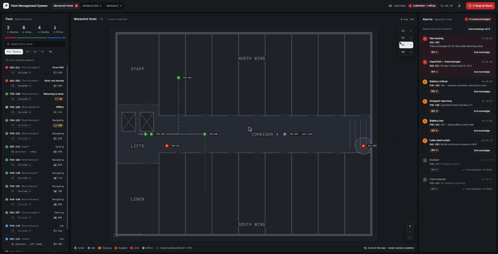
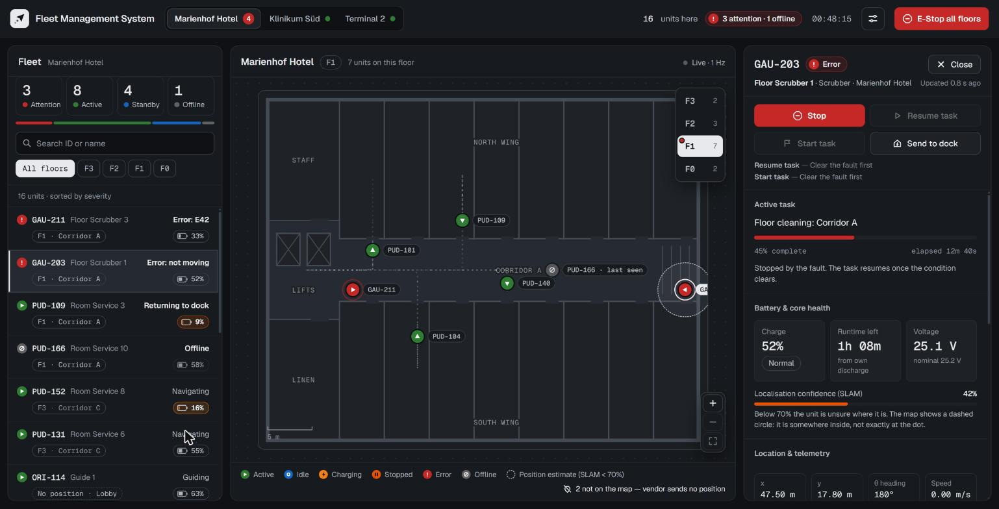
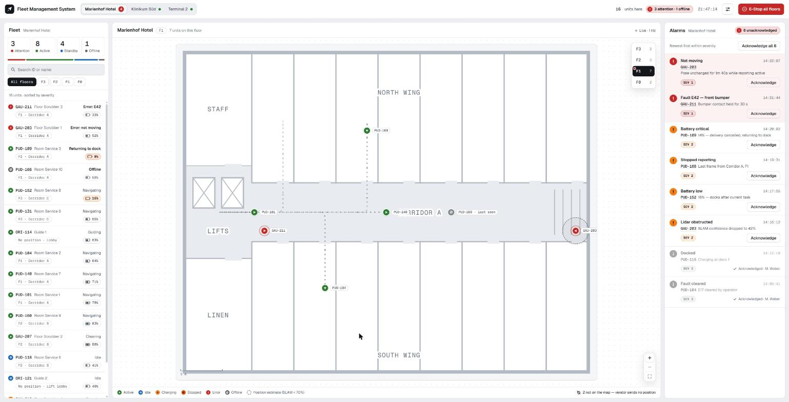
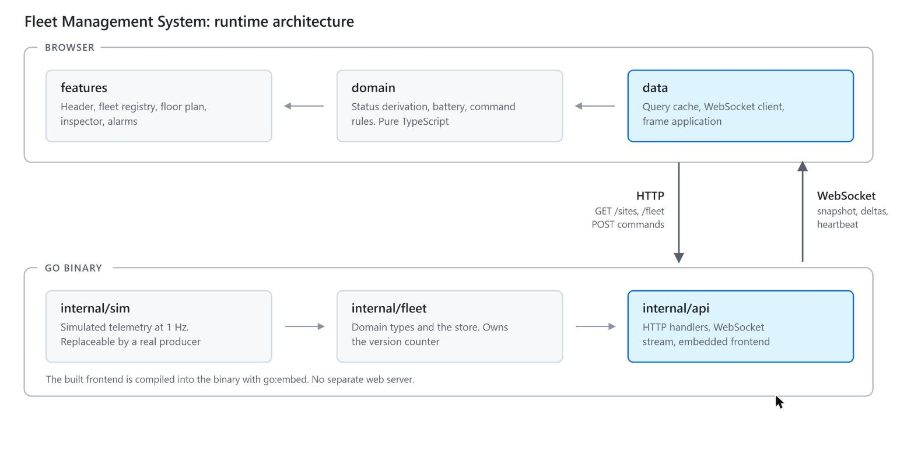

# Fleet Management System

Real-time monitoring and control for service robots across multi-storey indoor facilities.
One operator supervises robots in buildings: the UI shows fleet
status, robot positions on floor plans, and per-unit diagnostics, and sends commands.

A Go service streams telemetry over a WebSocket, a React frontend renders it, and both ship
as one binary.

**Live demo: https://fleet-management-system.fly.dev**



Selecting a unit opens its inspector: current task, battery and health, telemetry, and the
commands it will accept.



A light theme is available. Status colours are the same in both themes.



## Requirements

- Go 1.27+
- Node 22+ and pnpm 10+

## Build and run

```sh
pnpm install
pnpm run build     # builds the frontend, embeds it, compiles bin/server
pnpm start         # runs the binary
pnpm stop          # stops it (and the dev server), whatever terminal it was started from
```

Then open http://127.0.0.1:8080. The frontend is served by the binary; there is no separate
web server to start.

### Development

The build step embeds the frontend, so a rebuild is needed to see frontend changes. During
development, run the API and the vite dev server together instead:

```sh
pnpm run dev
```

Then open http://127.0.0.1:5173. Vite serves the frontend with hot reload and proxies
`/api` to the Go server on port 8080.

To start with one facility unreachable:

```sh
pnpm run dev:api -- -outage=clinic
```

### Docker

```sh
docker build -t fleet-management-system .
docker run -p 8080:8080 fleet-management-system
```

## Architecture



HTTP carries requests that need a response: configuration, the initial snapshot, and
commands. The WebSocket carries state changes pushed by the server.

Each published change increments a version counter by one. A client that receives
`version > local + 1` has missed a frame; it requests a snapshot and ignores deltas until it
arrives. The server drops frames for subscribers that cannot keep up, so a slow client does
not block the others.

Commands return `202 Accepted`. The unit's next telemetry frame confirms the result, so the
UI does not apply optimistic updates.

See [docs/architecture.md](docs/architecture.md) for details and
[docs/adr/](docs/adr/) for design decisions.

## API

| Transport | Carries                           | Specification                                  |
| --------- | --------------------------------- | ---------------------------------------------- |
| HTTP      | configuration, snapshot, commands | [docs/api/openapi.yaml](docs/api/openapi.yaml) |
| WebSocket | state changes                     | [docs/api/websocket.md](docs/api/websocket.md) |

## Project structure

```
backend/
  cmd/server/        entry point, flags, embedded frontend
  internal/fleet/    domain types and the store
  internal/sim/      simulated telemetry
  internal/api/      HTTP handlers and the WebSocket stream
frontend/
  src/domain/        status, battery, command rules (no React)
  src/data/          HTTP client, query cache, stream client
  src/features/      header, fleet, map, inspector, alerts
  src/components/    shared UI components
e2e/                 Playwright tests against the built binary
docs/                architecture, simulation, API specs, ADRs
scripts/             build helpers
```

## Tests

```sh
pnpm run check      # lint, type check, unit tests
pnpm run test:e2e   # Playwright; requires pnpm run build first
```

104 frontend unit tests, 45 backend tests, 13 end-to-end tests.

## Scope

### What I built, and why

All three parts: simulator, server and UI. The UI is where most of the time went, but a
fleet view on hard-coded fixtures would not have shown the part I think is actually hard
here, which is what happens between a telemetry frame arriving and an operator deciding to
act. That logic needs a real server, a real transport and a real failure mode.

The product question I answered: an operator supervising robots across buildings needs to
know what needs them now, whether the screen can be trusted, what happened to one unit, and
where it is. The three columns are those questions in priority order.

### What I faked, and why that was the right trade

**The robots.** `internal/sim` produces telemetry and calls the same store method a real
ingest path would. Everything downstream runs on real code: versioning, gap detection,
command validation, the stream, the whole UI. Faking further up would have cost the parts
worth showing; faking lower down would have meant a broker and a second deployable for a
seam that is one function call wide.

**Alarms.** Seeded rather than derived. Deriving them means a server-side timer watching for
readings that do *not* arrive, which is a day of work on its own and would have come out of
the UI budget.

**Floor plans.** Hand-authored vector geometry rather than the occupancy grids a real fleet
produces from SLAM. The coordinate frame is the same, so the rendering layer swaps without
touching the markers.

**Persistence and auth.** Left out entirely. Both are well-understood plumbing that would
have consumed time without demonstrating anything.

### What I would do differently in production

- **Derive alarms from telemetry** instead of seeding them. This is the one piece of
  business logic that is currently narrated rather than computed.
- **Replace the simulator with a real ingest path**, with batching, producer validation and
  per-unit rate limiting.
- **Add persistence.** A time-series store behind the existing store interface would make
  history and audit possible.
- **Push binary frames for pose.** At 1 Hz and this fleet size JSON is fine; at 10 to 30 Hz
  across thousands of units it is not.
- **Add the authorisation seam**: a principal on the handler and a site filter on stream
  subscribe.
- **A tablet layout.** Supervisors walk the building with a tablet, so this is the one
  missing viewport with a real user behind it. The three columns would collapse to two,
  with the inspector as an overlay. A phone layout matters less: triage and the map need
  the width.
- **Interaction coverage for the remaining components.** The domain and transport layers are
  well covered; the component tests cover the panels that carry the invariants, not all of
  them.

## Limitations

Telemetry is simulated. See [docs/simulation.md](docs/simulation.md) for what is simulated
and how to replace it.

Not implemented:

- **Authentication and multi-tenancy.** Acknowledgements are attributed to a fixed operator.
- **Telemetry ingestion.** No MQTT or HTTP ingest path, no producer validation or rate
  limiting.
- **Alarm derivation.** Alarms come from fixtures; a production system computes them from
  telemetry on a server-side timer.
- **Persistence.** State is in memory and lost on restart. No history or audit log.
- **Horizontal scaling.** Single instance. Multiple instances require a message bus and a
  replay buffer keyed by version.
- **Observability.** No metrics or tracing.
- **Tablet and phone layouts.** The grid is built for a desktop viewport and does not
  reflow below it.

## Licence

MIT
