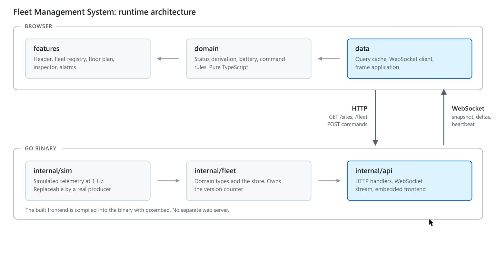

# Architecture



## Backend

Three packages:

| Package | Responsibility |
|---|---|
| `internal/fleet` | Domain types and the store. Owns the version counter and all writes |
| `internal/sim` | Simulated telemetry (see [simulation.md](simulation.md)) |
| `internal/api` | HTTP handlers, the WebSocket stream, the embedded frontend |

### Store

`fleet.Store` is the single writer. It publishes each update to all subscribers while
holding the write lock. Releasing the lock first allows two writers to deliver versions out
of order; a client that receives v6 before v5 discards v5 as stale and never detects the
gap.

Sends to subscribers are non-blocking. A subscriber that cannot keep up loses frames instead
of blocking the store. This is safe because every frame carries a version, so the client
detects the loss and requests a snapshot.

Delta frames omit each unit's trail and the client extends the history it holds, which cuts
a telemetry frame from roughly 22 KB to 6.5 KB. The cost is a constant shared by both sides
(the 60-point window) and a client that can no longer treat frames as self-contained. Both
are acceptable: the version counter already detects divergence and `resync` repairs it.

### Command validation

The server decides whether a command can run. The frontend disables controls it expects to
be rejected, but state can change between render and click, so the server validates again
and returns a reason the UI can display.

## Frontend

```
src/
  app/          application shell, view-state reducer, theme
  components/   shared UI components
  domain/       status, battery, command rules, plan geometry (no React)
  data/         HTTP client, query cache, WebSocket client, frame application
  features/     header, fleet, map, inspector, alerts
  lib/          formatting helpers
  styles/       design tokens and base styles
```

Modules in `features/` import from `components/`, `domain/` and `lib/`, never from each
other. CI enforces this.

### State

Server state lives in the TanStack Query cache and is written only by the stream client.
View state (selection, filters, zoom, theme, pending confirmations) lives in a reducer in
`app/ui-state.ts`. The two are never mixed, so a UI interaction cannot write into state that
the next telemetry frame overwrites.

`deriveFleet(snapshot)` runs once per frame and produces the state, bucket, triage rank and
status text for each unit. All three columns render that result, so they cannot disagree.

### Rendering

Map pan and zoom write a transform directly to the DOM through a ref. Pointer events fire at
screen refresh rate, and routing them through React state drops frames.

## Derived values

None of the following appear in telemetry; all are computed:

| Value | Derived from | Notes |
|---|---|---|
| Facility outage | all units at a site silent | Reported as one condition, not one per unit |
| `estop` / `stopped` vs fault | operator action vs reported state | A stop never overrides a fault |
| Status buckets | reported state and battery level | Seven states collapse into four counters |
| Command availability | state, battery, zone, link | Validated on the server |
| Runtime remaining | the unit's own discharge rate | Not produced for charging or silent units |

## Invariants

Each of the following has a test:

1. The four status counters sum to the fleet size.
2. An emergency stop never lowers the attention count.
3. All units at a facility going silent is one condition, not N.
4. A fault takes precedence over both kinds of stop.
5. Every blocked action carries a reason.
6. No runtime estimate for charging or silent units.
7. Acknowledgement does not reassign an alarm that already has an owner.
8. The version counter increments by exactly one per change.
9. Versions reach subscribers in order under concurrent writes.
10. A slow subscriber loses frames instead of blocking the store.
11. A missed frame is detected and repaired.
12. Required lists are never serialised as `null`.
13. A client receives a snapshot before any delta and can request another.
14. A dropped connection reconnects with exponential backoff and jitter.
15. A replaced WebSocket never writes to application state.
16. Switching facility clears all filters.
17. No axe accessibility violations in either theme.
18. All controls are reachable and operable by keyboard.

## Dependencies

Runtime: `react`, `react-dom`, `@tanstack/react-query` on the frontend;
`github.com/coder/websocket` on the backend. Everything else is standard library.

The WebSocket library handles masking, fragmentation, close codes, ping/pong and the upgrade
handshake. Each is easy to get subtly wrong, and a framing bug looks like a flaky network
rather than a defect.

Not used: ORM, state management library, router, component library, charting library,
Tailwind. The frontend is a single screen with eight shared components and a token file.

### Supply chain

- `pnpm-lock.yaml` is committed; CI installs with `--frozen-lockfile`.
- Postinstall scripts are disabled in `pnpm-workspace.yaml`. The one package that requests
  one is denied, and the build was verified to work without it.
- GitHub Actions are pinned by commit SHA.
- `govulncheck` runs against the Go module in CI.
